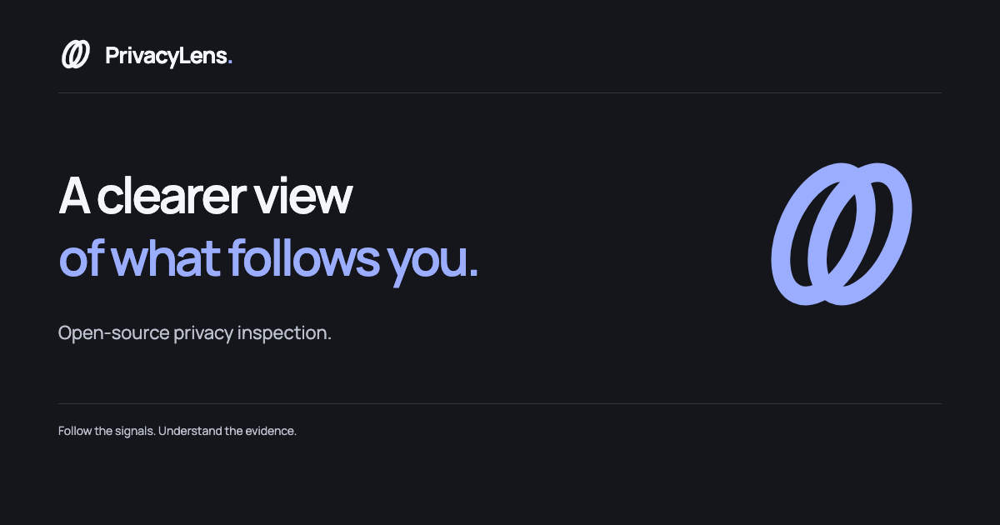
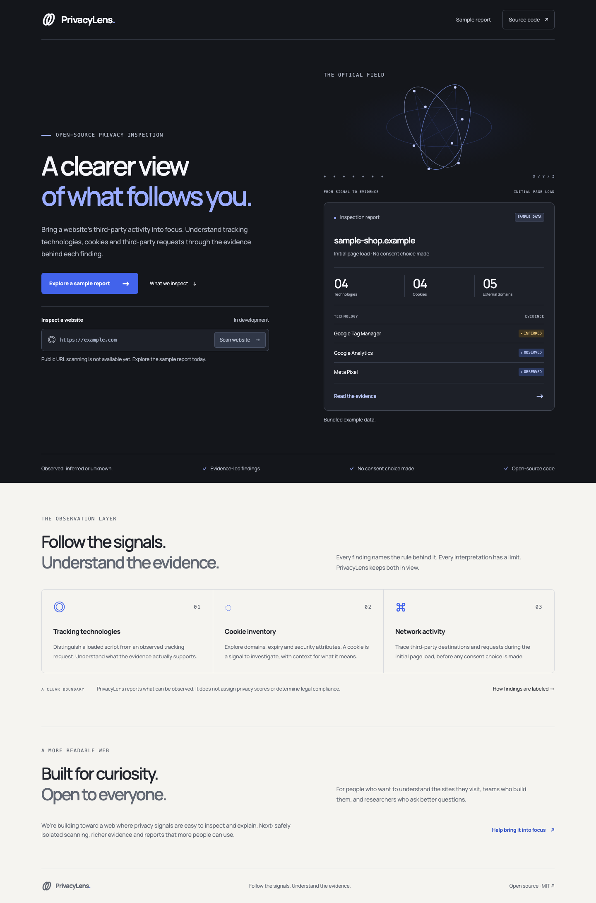
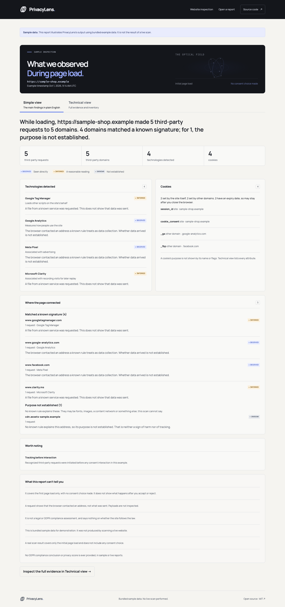

<p align="center">
  <a href="#explore-privacylens">Explore the product</a> ·
  <a href="#where-were-going">Our direction</a> ·
  <a href="#run-it-locally">Get started</a> ·
  <a href="CONTRIBUTING.md">Contribute</a>
</p>

PrivacyLens is an open-source project that helps people understand the privacy
signals of a website. It brings tracking technologies, cookies and third-party
network activity into a readable report, with the evidence behind each finding.

We want anyone to be able to ask **“What happens when I visit this site?”** and
get a clear, useful answer. The website we're building turns browser observations
into something people can explore, understand and question.

> **Product preview:** explore the bundled sample report today. Public URL
> scanning is in development and remains disabled; its URL field is visibly inactive on the homepage.

## Who it's for

- **Curious people** who want to understand the signals behind a site's privacy choices.
- **Website teams** who want a clearer view of the technologies and destinations their pages introduce.
- **Researchers, educators and contributors** who want an open foundation for investigating and explaining web privacy.

## Explore PrivacyLens

The current web experience pairs an introduction to privacy inspection with a
detailed, evidence-led report with an animated optical header and interactive
request timing view. These are real screenshots of the application
running locally, using synthetic example data.



**Follow a finding all the way to its evidence.** The sample report lets you explore request timings and shows detected
technologies, cookie attributes, third-party destinations and possible consent
manager signals from the initial page load. Each finding is labeled observed,
inferred or unknown.

<details>
<summary>Explore the full report: optical header, interactive request window and detailed evidence</summary>



</details>

[View the mobile homepage](docs/assets/home-mobile.png) ·
[View the mobile report](docs/assets/report-mobile.png)

After [starting the app](#run-it-locally), open
the sample report (`/sample` when running locally). It is bundled demonstration
data, with no live website scanned.

## Evidence you can understand

| Signal                | What PrivacyLens brings into view                                                 |
| --------------------- | --------------------------------------------------------------------------------- |
| Tracking technologies | Recognized technologies, their categories and the evidence supporting detection.  |
| Cookies               | First- and third-party domains, expiry, Secure, HttpOnly and SameSite attributes. |
| Network activity      | Third-party destinations and request timing before consent interaction.           |
| Consent signals       | Possible consent manager presence, with the supporting signal.                    |

Every report separates **observed** browser evidence, **inferred**
interpretations and what remains **unknown**. PrivacyLens does not assign privacy
scores or make legal compliance verdicts.

**Available now:** the homepage, a deterministic sample report and a browser
collector that developers can exercise against fixed local fixtures.
The sample illustrates the report format; it is not a measurement of a real site.

## Where we're going

Our ambition is a more readable web: privacy inspection that people can use
without needing to become browser specialists.

| Direction               | What we're working toward                                                                                                    |
| ----------------------- | ---------------------------------------------------------------------------------------------------------------------------- |
| Safe website inspection | A local command-line scanner first, then real results in the web interface, then hosted scanning once isolation is verified. |
| Deeper evidence         | Broader technology coverage, clearer detection explanations and explicit observation limits.                                 |
| More useful reports     | Accessible exploration, report export and comparison across observation windows.                                             |
| An open foundation      | Documentation, reproducible fixtures and a contribution path for detectors, design and language.                             |

These are planned directions, not released features or delivery promises.
Read the [product direction](docs/product-direction.md) for the current
foundation, next steps and release gates.

## Run it locally

Use **Node.js 24 LTS** and npm:

```sh
npm ci
npx playwright install chromium
npm run dev
```

Open <http://127.0.0.1:3000> after `npm run dev`, then choose **Explore a sample report**.
No accounts, API keys or environment files are needed.

For fixture development, verification commands and the project map, see
[the development guide](docs/development.md). The development server stays on
loopback; public scanning remains disabled.

## Scan a website on your machine

The local scanner is in development for v0.1.0 and is not released. With the
setup above and Chromium installed (`npx playwright install chromium`):

```sh
npm run scan -- https://example.org --out report.json
```

It visits the page once in headless Chromium, waits a few seconds for delayed
requests and writes an evidence report as JSON. Nothing on the page is clicked.
All browser traffic goes through a local filter that refuses private, local and
cloud-metadata addresses, so a page cannot reach your own network, and Chromium
runs with its sandbox on and with memory, download and time limits. The report
holds origins, cookie names and attributes, and timing, and records each request
as `observed`, `inferred` or `unknown`. It does not hold cookie values, request
payloads, headers, URL paths or query strings. See
[architecture](docs/architecture.md#local-cli-scanner-v010-in-development) for the
design and its limits. Public URL scanning through the website stays disabled.

## Build it with us

Help improve the explanations, test report accessibility, add reproducible
detector fixtures or shape the next product capabilities. Start with
[CONTRIBUTING.md](CONTRIBUTING.md), open an
[issue](https://github.com/aiagui/privacylens/issues), or propose a focused pull request.

Explore the [roadmap](docs/roadmap.md), the [isolated-scanning proposal](docs/proposal-isolated-scanning.md),
[signatures](docs/signatures.md), the [architecture](docs/architecture.md),
[security boundaries](docs/security.md) and
[visual identity](docs/visual-identity.md). To report a vulnerability privately,
follow [SECURITY.md](SECURITY.md).

PrivacyLens is [MIT licensed](LICENSE). Follow the signals. Understand the evidence.
